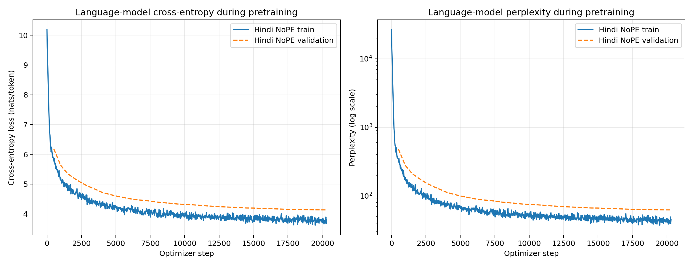
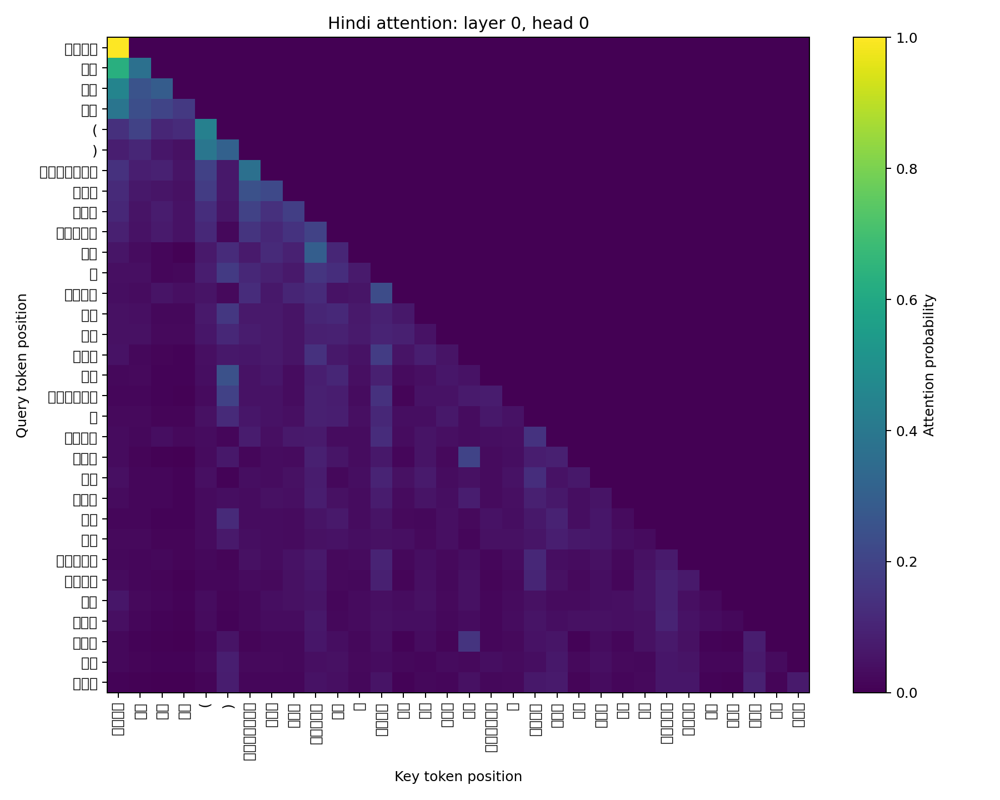
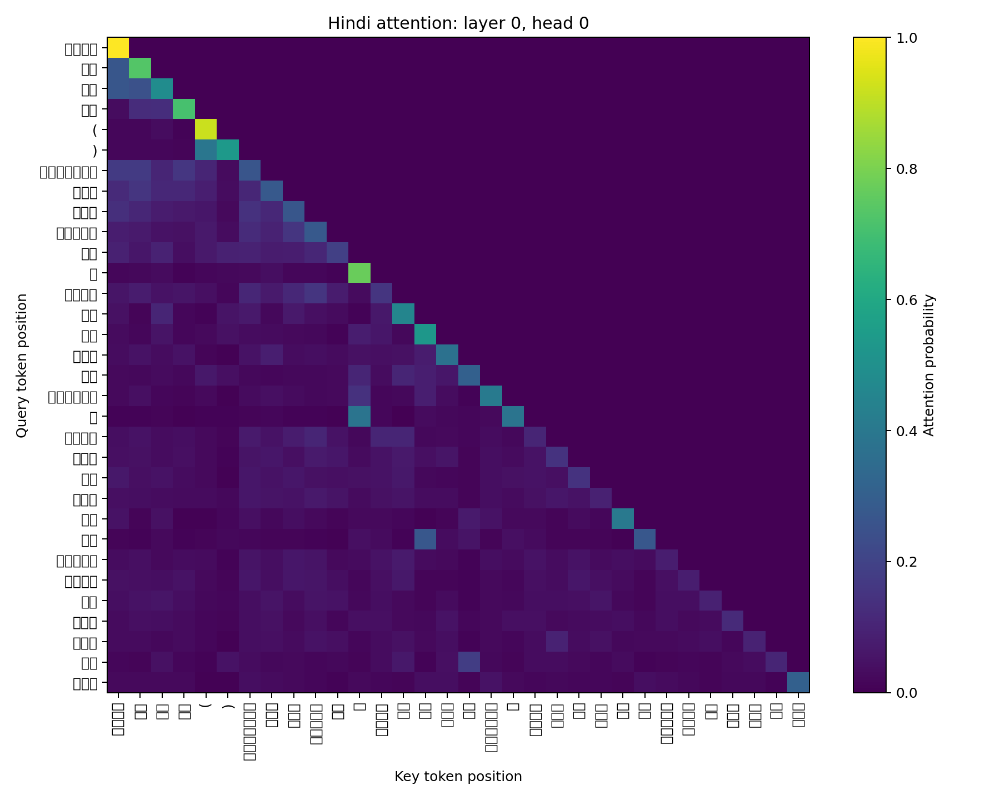
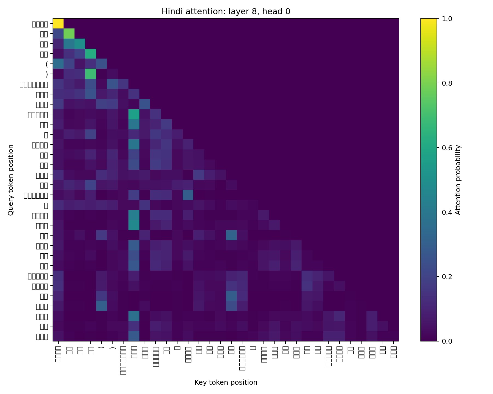
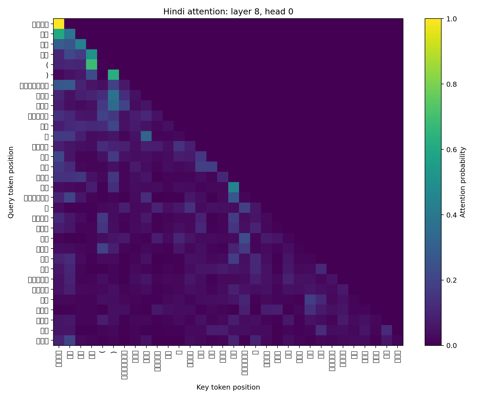

# Bonus: Hindi Model Without Positional Embeddings

**Language:** Hindi (Model H)  
**Ablation:** learned absolute positional embeddings removed  
**Training budget:** 20,300 optimizer steps; 332,595,200 tokens

## 1. Experimental control

The ablated model uses the same Hindi corpus, 24,000-piece Unigram tokenizer, 256-token context,
nine-layer decoder, six attention heads, optimizer, learning-rate schedule, batching, random seed,
and evaluation protocol as the standard Phase 2 Hindi model. The only architectural change is that
token embeddings enter the first Transformer block without adding learned absolute-position
embeddings. The causal attention mask remains unchanged.

Removing the `256 x 384` position table removes 98,304 parameters. The standard model has
25,285,248 parameters and the ablated model has 25,186,944, a 0.39% reduction. No width was added
to compensate because doing so would introduce a second architectural change.

## 2. Training

Training completed on a Kaggle T4 GPU with bfloat16 arithmetic. The ablated model processed the
same 332,595,200-token budget as the standard model. Its final validation loss was 4.1346
(perplexity 62.46), compared with 4.0954 (60.06) for the standard model. Both curves converged
normally; removing explicit positions did not prevent causal language-model learning.

## 3. Held-out language modeling

Both checkpoints were rescored on all 3,521,022 next-token targets in the unchanged Hindi Phase 2
test stream. The standard-model reproduction exactly matches the Phase 2 report.

| Metric | Standard | No position | Relative change |
|---|---:|---:|---:|
| Cross-entropy (nats/token) | 3.6782 | 3.7161 | +1.03% |
| Perplexity | 39.57 | 41.10 | +3.86% |
| Bits per UTF-8 byte | 0.5282 | 0.5336 | +1.03% |

The consistent but modest degradation indicates that learned absolute positions improve Hindi
next-token prediction, while the causal decoder retains substantial position-sensitive behavior
without them.

## 4. Generation evaluation

The evaluation uses the same 50 deterministically selected test documents, 32-token prefixes,
64-token continuations, and sampling seed for both models.

| Decoding | Model | BLEU-4 | chrF++ | ROUGE-L | Distinct-1 | Distinct-2 | Repeated 4-gram |
|---|---|---:|---:|---:|---:|---:|---:|
| Greedy | Standard | 1.016 | 9.341 | 0.102 | 0.153 | 0.283 | 0.636 |
| Greedy | No position | 0.823 | 8.417 | 0.090 | 0.140 | 0.264 | 0.644 |
| Temperature 0.5 | Standard | 1.417 | 12.442 | 0.115 | 0.235 | 0.536 | 0.215 |
| Temperature 0.5 | No position | 0.587 | 11.243 | 0.100 | 0.226 | 0.482 | 0.309 |
| Temperature 1.0 | Standard | 0.417 | 13.354 | 0.092 | 0.493 | 0.897 | 0.002 |
| Temperature 1.0 | No position | 0.458 | 15.567 | 0.100 | 0.457 | 0.872 | 0.006 |
| Temperature 1.5 | Standard | 0.112 | 14.145 | 0.042 | 0.767 | 0.998 | 0.000 |
| Temperature 1.5 | No position | 0.182 | 14.233 | 0.045 | 0.760 | 0.996 | 0.000 |

Greedy and low-temperature generation degrade most clearly: overlap falls, diversity decreases,
and repetition rises. On the first fixed prefix, the standard greedy model repeats `एक साथ`, while
the ablated model repeats the longer prefix-derived phrase `एक फ्रंट हैंडस्प्रिंग के साथ`. At
temperature 1.0 the ablated model obtains higher reference overlap, showing that the effect is not
uniform across decoding settings. These single-reference metrics remain weak measures of open-ended
generation, so no isolated metric is treated as a general fluency score.

## 5. Attention analysis

| Layer | Model | Mean entropy | Mean attention distance |
|---:|---|---:|---:|
| 0 | Standard | 2.3601 | 6.8388 |
| 0 | No position | 2.1249 | 5.8159 |
| 8 | Standard | 1.8213 | 6.9136 |
| 8 | No position | 1.7129 | 6.0574 |

| Standard early/late heads | No-position early/late heads |
|---|---|
|  |  |
|  |  |

The no-position model has lower entropy and shorter mean attention distance in both summarized
layers. On this fixed prefix its attention is therefore sharper and more local. This is descriptive
evidence from one prompt, not proof that every head or input behaves this way.

## 6. What breaks without explicit position information

Without the position table, the input representation no longer tells the network that an otherwise
identical token occurred at absolute index 5 rather than 50. This removes a direct signal for
distance, order, and position-specific behavior. The model is not permutation-invariant, however:
the causal mask gives later queries access to more predecessors than earlier queries. The results
show that this asymmetric context is sufficient for much of the original performance, but not all
of it. Test perplexity rises, low-temperature generation becomes more repetitive, and attention
shifts toward shorter distances.

## 7. Reproducibility

- Ablation config: `hindi/configs/phase2_no_position.toml`
- Kaggle notebook: `kaggle/bonus_hindi_no_position.ipynb`
- Kaggle runner: `kaggle/run_bonus_hindi_no_position.py`
- Artifact identities: `report/results/generated/bonus/no_position/artifact_manifest.json`
- Complete compact results: `report/results/generated/bonus/no_position/`
- Heatmaps and curve: `report/figures/generated/bonus/no_position/`

The original resume checkpoint is `checkpoint_step_0020300.pt`, SHA-256
`e39b6c2d6fce3ae9411d395ac7924318fc5be6b8545eb878b5e0cba2f88d72b1`. For safe distribution,
its model state was exported tensor-for-tensor as `checkpoint_step_0020300.safetensors`, SHA-256
`8abac7de6c47cd1978bc9b7d980020f5dbf358fe48bebc0ad2c843940b155c86`. The SafeTensors file is
non-executable and reloads directly through the evaluation script. Its JSON sidecar records the
complete config, training step, token count, and source-checkpoint hash. Large checkpoint files
remain outside Git and are stored under `hindi/bonus_no_position/` in the linked project Drive.
