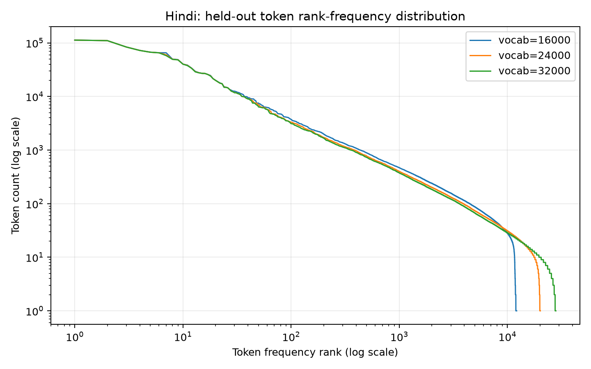
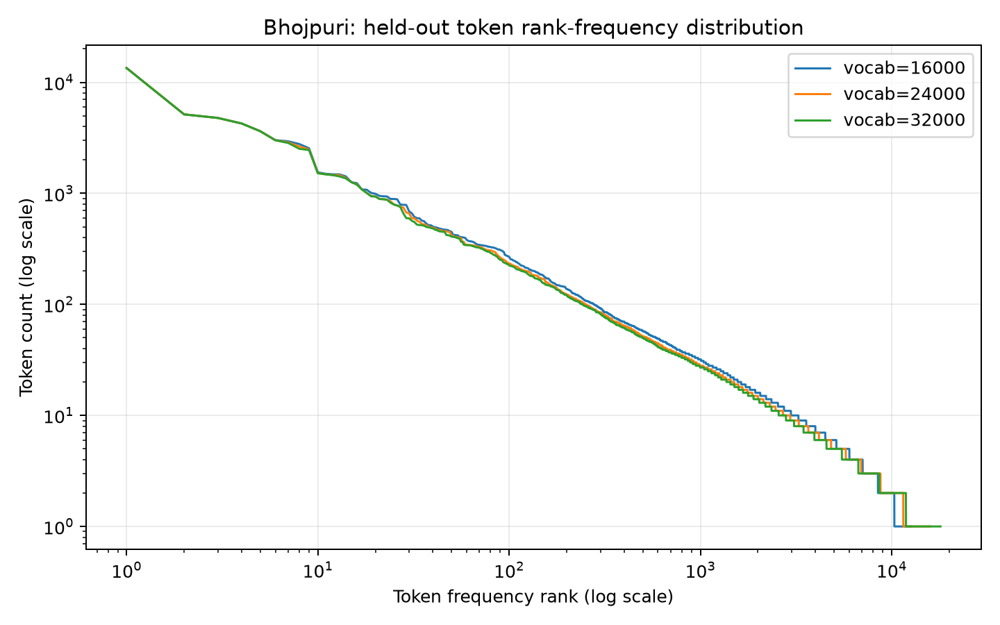

# Phase 1: Data Collection and Tokenizer Construction

## 1. Language selection

- **Language #1 (Model H):** Hindi (`hi`, Devanagari script), selected as the higher-resource Indian language due to abundant availability of public digital text, governmental archives, and encyclopedic resources.
- **Language #2 (Model L):** Nepali (`ne`, Devanagari script), selected as Language #2, targeting ~300M tokens with $\ge 20\%$ manually collected data (achieving 258.7M train tokens at 22.77% manual tokens). In addition, Bhojpuri (`bho`, Devanagari script) is preserved as an approved low-resource comparison language and corpus.

The corpora, tokenizers, vocabulary artifacts, training splits and model weights are independent. Token strings can naturally coincide because both languages use Devanagari; there is no shared embedding table or tokenizer.

---

## 2. Corpus collection

### 2.1 Source inventory

| Language | Source | Collection type | Method | Licence | Clean training tokens |
|---|---|---|---|---|---:|
| Hindi | PIB Hindi | Manual | Polite release crawl / DOM extraction | Reproduction with attribution | 446,674 |
| Hindi | Hindi Wikipedia | Manual | MediaWiki Action API (v6 cleaned) | CC BY-SA 4.0 | 65,666,897 |
| Hindi | Hindi Wikisource | Manual | MediaWiki Action API | CC BY-SA 4.0 | 12,382,392 |
| Hindi | Hindi Wikibooks | Manual | MediaWiki Action API | CC BY-SA 4.0 | 4,151,331 |
| Hindi | IndicCorp v2 (`data/hi-{1,2,3}.txt`) | Downloaded | Hugging Face streaming | CC0-1.0 | 248,972,606 |
| **Hindi Total** | | | | | **332,246,742** |
| Bhojpuri | Bhojpuri Wikisource | Manual | MediaWiki Action API | CC BY-SA 4.0 | 53,205 |
| Bhojpuri | Bhojpuri Wikipedia | Manual | MediaWiki Action API (v4 cleaned) | CC BY-SA 4.0 | 1,689,774 |
| Bhojpuri | Maina Bhojpuri | Manual | Blogger structured JSON feed | Source rights retained; course research | 768,163 |
| Bhojpuri | Bhojpuri News | Manual | Blogger structured JSON feed | Source rights retained; course research | 871,582 |
| Bhojpuri | Anjoria (pre-2023 pilot) | Manual | Sitemap-enumerated public HTML + LLR | Source rights retained; course research | 1,695,362 |
| Bhojpuri | Filtered BhojpuriCorpus | Downloaded | Hugging Face streaming | Mixed per record | 17,499,677 |
| **Bhojpuri Total** | | | | | **22,577,763** |

---

### 2.2 Collection process

All raw data collectors write to a unified, provenance-tracking document schema (`src/lma_phase1/schema.py`), recording `document_id`, `text`, `source_name`, `source_url`, `collection_type` (`manual` vs. `downloaded`), `collection_date`, `license`, and structured `metadata`.

- **Hindi Manual Sources**: Namespace-0 page dumps from Hindi Wikipedia, Wikisource, and Wikibooks were gathered using rate-limited MediaWiki Action API collectors with checkpoint continuation. Press Information Bureau (PIB) Hindi articles were collected and imported with body verification, quarantining Akamai access-denied responses.
- **Hindi Downloaded Source**: IndicCorp v2 Hindi was streamed from three raw text shards (`data/hi-1.txt`, `data/hi-2.txt`, `data/hi-3.txt`) directly into compressed JSONL.
- **Bhojpuri Manual Sources**: In addition to Bhojpuri Wikipedia and Wikisource, two dedicated Bhojpuri literary blog archives (Maina and Bhojpuri News) were collected through Blogger feeds, filtering out posts with translation labels (`अनुवाद`). Anjoria articles modified before 2023 were extracted via public XML sitemaps.
- **Bhojpuri Downloaded Source**: BhojpuriCorpus was streamed with strict partition filtering to discard translation/parallel benchmark splits (`eng_bho`, `google_smol`, `fleurs_bhojpuri`).

---

### 2.3 Cleaning and quality filtering

Preprocessing enforces a strict multi-stage filtering cascade:
1. **Unicode NFC Normalization**: Devanagari text is normalized to NFC, converting irregular combining character sequences into canonical representations, removing zero-width non-joiners (`\u200c`) and zero-width joiners (`\u200d`) that produce invisible encoding fragmentation, and converting HTML entities.
2. **Boilerplate & Line Repetition**: Lines $\ge 20$ characters appearing 3+ times in the same document are stripped.
3. **Source-Specific Cleaning**:
   - *Wikipedia / Wikibooks*: Strips leading and residual `{{template}}` blocks, HTML tags/comments, table markup (`{|`, `|-`, `|}`), category headers (`श्रेणी:`), media captions, and truncates trailing reference/external-link sections.
   - *PIB*: Removes entry-date/byline lines (`प्रविष्टि तिथि:`), release IDs (`(रिलीज़ आईडी:`), signature blocks, and embedded English paragraphs.
   - *Anjoria*: Truncates social-media comments, category navigation lists, and footer boilerplate.
4. **Script & Quality Heuristics**:
   - Hindi thresholds: $\ge 200$ characters, $\ge 30$ words, $\ge 70\%$ Devanagari letter ratio, $\le 20\%$ Latin letter ratio, $\le 25\%$ digit ratio.
   - Bhojpuri thresholds (lenient low-resource floor): $\ge 30$ characters, $\ge 5$ words, $\ge 70\%$ Devanagari ratio, $\le 20\%$ Latin ratio, $\le 25\%$ digit ratio.
5. **Statistical Language Identification**: For mixed sources like Anjoria, a character 4-gram log-likelihood-ratio (LLR) classifier trained on held-out Hindi and Bhojpuri seed corpora separated authentic Bhojpuri from Hindi promotional text.

---

### 2.4 Deduplication

Deduplication was conducted in three hierarchical phases, preserving manual document priority:
1. **Exact Document Deduplication**: SHA-256 hashing of NFC-normalized, whitespace-collapsed, case-folded text. Manual documents were indexed first, dropping identical downloaded copies. (Removed 3,028 duplicates in Hindi; 1,312 in Bhojpuri).
2. **Corpus-Wide Exact Paragraph Deduplication**: Paragraphs with $\ge 100$ characters and $\ge 15$ words were indexed in SQLite. If an identical paragraph appeared in an earlier document, it was removed. If paragraph removal reduced the document below 200 characters / 30 words, the document was dropped. (Removed 29,625 duplicate paragraphs and 16,565 empty/short documents in Hindi; 7,488 paragraphs in Bhojpuri). An audit of 40 sampled pairs confirmed valid removal of shared boilerplates and cross-source chapter repeats with zero false positives.
3. **Near-Duplicate Detection via Bottom-k MinHash**: Bottom-k MinHash over word 5-grams (similarity threshold $s = 0.95$, sketch size $k = 64$, index size $b = 16$). For Hindi, only manual documents were indexed to eliminate cross-source duplicates without over-pruning upstream IndicCorp text. (Removed 158 near-duplicates in Hindi; 4,463 in Bhojpuri).

---

### Final training recount (11 September 2026)

Every final decontaminated training document was re-encoded with the released tokenizer.
The reconstructed packed stream matches the published Phase 2 SHA-256 for both languages.
Raw content counts exclude EOS; the packed count includes one EOS per document.

| Language | Final train documents | Raw content tokens | Manual content tokens | Manual fraction | Packed tokens (with EOS) |
|---|---:|---:|---:|---:|---:|
| Hindi | 2,237,942 | 334,757,275 | 85,857,319 | 25.6476% | 336,995,217 |
| Bhojpuri | 225,689 | 22,917,286 | 5,453,089 | 23.7947% | 23,142,975 |

Both final training corpora exceed 20% manual content tokens. Assigning each EOS to its source
document gives packed manual fractions of 25.5058% Hindi and 23.6302% Bhojpuri. Independently
normalizing whitespace gives 332,150,099 Hindi / 22,371,425 Bhojpuri training tokens, with
manual fractions 25.0640% / 21.9352%. These are different denominators, not competing estimates.
The recount verifies recorded collection types and token counts; it is not a fresh manual
review of the linguistic quality or collection classification of every source.

Evidence: [final_training_recount.json](audits/generated/final_training_recount.json).
The historical pre-decontamination tables below are retained as historical records.

### 2.5 Historical Phase 1 dataset statistics

After deterministic downsampling of downloaded records to achieve a $\ge 22\%$ manual-word buffer, corpora were partitioned using a **98% / 1% / 1%** document-level split with cryptographic hashing on document and work group IDs. The following is the historical pre-decontamination summary, not a fresh count of the final packed training streams. Hindi's held-out normalized counts were later corrected to 3,429,056 validation tokens and 3,468,316 test tokens; the historical overall totals therefore should not be reused as current totals.

| Language | Split | Documents | Tokens | Manual tokens | Downloaded tokens | Manual token fraction |
|---|---|---:|---:|---:|---:|---:|
| **Hindi** | Train | 2,237,951 | 332,246,742 | 83,274,136 | 248,972,606 | **25.06%** |
| Hindi | Validation | 23,033 | 3,428,944 | 859,881 | 2,569,063 | 25.08% |
| Hindi | Test | 22,773 | 3,372,824 | 839,451 | 2,533,373 | 24.89% |
| **Hindi Overall** | | **2,283,757** | **339,048,510** | **84,973,468** | **254,075,042** | **25.06%** |
| **Bhojpuri** | Train | 225,992 | 22,577,763 | 5,078,086 | 17,499,677 | **22.49%** |
| Bhojpuri | Validation | 2,344 | 227,239 | 50,949 | 176,290 | 22.42% |
| Bhojpuri | Test | 2,351 | 214,399 | 52,302 | 162,097 | 24.39% |
| **Bhojpuri Overall** | | **230,687** | **23,019,401** | **5,181,337** | **17,838,064** | **22.51%** |
| **Nepali** | Train | 705,137 | 258,736,416 | 58,921,054 | 199,815,362 | **22.77%** |
| Nepali | Validation | 7,380 | 2,790,499 | 624,970 | 2,165,529 | 22.39% |
| Nepali | Test | 7,354 | 2,738,274 | 695,137 | 2,043,137 | 25.39% |
| **Nepali Overall** | | **719,871** | **264,265,189** | **60,241,161** | **204,024,028** | **22.80%** |

> [!NOTE]
> **Token-Count Reconciliation between Phase 1 and Phase 2**:
> The token counts in the table above reflect whitespace-normalized SentencePiece encoding (`normalize_tokenizer_input()`), which was used during Phase 1 corpus analysis. In Phase 2, token streams were packed directly from raw text before appending one `<eos>` token per document to form contiguous training and evaluation streams (see [`heldout_recomputation.json`](audits/generated/heldout_recomputation.json)).
> - **Hindi Test**: Phase 2 packed test stream contains **3,521,023 tokens** = 3,498,250 raw tokens + 22,773 document EOS tokens. Re-encoding the identical decontaminated test split with Phase 1 whitespace normalization yields **3,468,316 tokens** (a 29,934 token difference due to raw vs. normalized whitespace, plus a 95,492 token reconciliation from the preliminary Phase 1 summary count).
> - **Bhojpuri Test**: Phase 2 packed test stream contains **222,585 tokens** = 220,234 raw tokens + 2,351 document EOS tokens. Re-encoding with whitespace normalization yields **214,399 tokens**, matching Phase 1's reported count exactly.

#### Justification for Bhojpuri Dataset Size Shortfall
Hindi's historical training summary was **332.25M tokens**, below the approximately 500M training-token target. The final packed stream contains **336.995M tokens**, including EOS. Filtering, the collected manual-text budget and compute constraints limited the completed experiment; the explicit lower-resource shortfall allowance does not automatically exempt Hindi, and no grading exception is claimed. Bhojpuri's historical training summary was **22.58M tokens**, with the following justification for its permitted lower-resource shortfall:
1. **Scarcity of Native Monolingual Text**: High proportions of online "Bhojpuri" text are machine-translated benchmark subsets (which were deliberately excluded to preserve linguistic authenticity) or Hindi text mistakenly tagged as Bhojpuri.
2. **Exclusion of Non-Devanagari / OCR-Scrambled Data**: Scanned PDF magazines (e.g., Sirijan, Diya Bati) produced corrupted Devanagari combining mark orders and were omitted to protect corpus quality.
3. **Manual Ratio Compliance**: Maintaining a valid 22.49% manual token fraction required capping downloaded records proportionally to the ~5.18M manual tokens collected.

---

## 3. Tokenizer construction

Separate **SentencePiece Unigram** tokenizers were trained from scratch exclusively on each language's training split (`character_coverage=1.0`, `split_digits=True`, `normalization_rule=identity`). Candidate vocabulary sizes were evaluated on held-out validation splits:

| Language | Vocabulary size | Fertility (tokens/word) | Characters / token | UNK rate | Held-out vocab utilization |
|---|---:|---:|---:|---:|---:|
| **Hindi** | 16,000 | 1.3562 | 3.800 | 0.001418% | 76.04% |
| **Hindi** | **24,000** | **1.2928** | **3.986** | **0.001487%** | **83.93%** |
| **Hindi** | 32,000 | 1.2630 | 4.080 | 0.001522% | 87.64% |
| **Bhojpuri** | **16,000** | **1.3341** | **3.764** | **0.001760%** | **78.79%** |
| **Bhojpuri** | 24,000 | 1.2809 | 3.921 | 0.001833% | 66.40% |
| **Nepali** | 16,000 | 1.3548 | 4.800 | 0.001733% | 92.97% |
| **Nepali** | **24,000** | **1.2844** | **5.063** | **0.001828%** | **95.23%** |
| **Nepali** | 32,000 | 1.2460 | 5.220 | 0.001884% | 96.03% |
| **Bhojpuri** | 32,000 | 1.2546 | 4.003 | 0.001872% | 56.29% |




---

### 3.1 Selected tokenizers

- **Hindi (Selected: 24,000 Unigram)**:
  - **Fertility & Subwords**: Fertility drops significantly from 1.3562 (16k) to 1.2928 (24k), capturing key compound morphemes with 83.93% held-out vocabulary utilization.
  - **Parameter Budget Allocation**: In our final Phase 2 model architecture ($d_{\text{model}} = 384$, 25,285,248 total parameters; initially projected at $d_{\text{model}} = 512$ in early planning), the 24,000-piece embedding table uses $24,000 \times 384 = 9,216,000$ parameters (36.45% of the total parameter budget), leaving the remaining 16,069,248 parameters (63.55%) for deep multi-head attention and feed-forward layers. A 32k vocabulary would have consumed 12.29M parameters (~49% of the budget) in embeddings alone.
- **Bhojpuri (Selected: 16,000 Unigram)**:
  - **High Utilization**: The 16,000 vocabulary achieves 78.79% utilization on held-out text with low fertility (1.3341) and an unknown rate of 0.00176%. Larger vocabularies (24k/32k) exhibit steep drops in utilization (down to 56.29%) and overfit rare morphological variations in the smaller corpus.
  - **Parameter Saving**: With $d_{\text{model}} = 384$, the 16,000-piece vocabulary requires $16,000 \times 384 = 6,144,000$ parameters (24.70% of the 24,870,912 total model parameters), leaving 18,726,912 parameters (75.30%) for Transformer depth.

---

### 3.2 Tokenization examples

#### Example 1: Standard Devanagari Prose & Inflections
- **Original (Hindi)**: `शिक्षा मंत्रालय ने छात्रवृत्ति योजना के लिए आवेदन आमंत्रित किए हैं।`
- **Tokens (24k)**: `[' शिक्षा', ' मंत्रालय', ' ने', ' छात्रवृत्ति', ' योजना', ' के', ' लिए', ' आवेदन', ' आमंत्रित', ' किए', ' हैं', '।']`
- **Analysis**: Full word-level segmentation for frequent administrative and grammatical particles (`मंत्रालय`, `छात्रवृत्ति`, `के लिए`).

#### Example 2: Bhojpuri Verbal Morphology & Postpositions
- **Original (Bhojpuri)**: `ऊ लोगन के घरे जाके सब बात बतावे के चाहीं।`
- **Tokens (16k)**: `[' ऊ', ' लोगन', ' के', ' घरे', ' जाके', ' सब', ' बात', ' बतावे', ' के', ' चाहीं', '।']`
- **Analysis**: Preserves dialect-specific oblique markers and verbal inflections (`लोगन`, `घरे`, `बतावे`, `चाहीं`) as complete subwords.

#### Example 3: Compound Words & Rare Stems
- **Original (Hindi)**: `दूरसंचार अवसंरचना विकास प्राधिकरण`
- **Tokens (24k)**: `[' दूर', 'संचार', ' अव', 'संरचना', ' विकास', ' प्राधिकरण']`
- **Analysis**: Clean prefix and root decomposition (`दूर + संचार`, `अव + संरचना`).

#### Example 4: Numeric Handling
- **Original**: `15 अगस्त 1947`
- **Tokens (24k)**: `[' 1', '5', ' अगस्त', ' 1', '9', '4', '7']`
- **Analysis**: `split_digits=True` isolates individual digits, preventing combinatorial vocabulary explosion for calendar years.

---

## 4. Reproducibility

- **Python Version**: Python 3.12 (Apple Silicon / macOS)
- **Key Dependencies**: `sentencepiece>=0.2`, `datasets>=3.0`, `beautifulsoup4>=4.12`, `matplotlib>=3.8`
- **Deterministic Seeds**:
  - Preprocessing & Dedup Hash: `lma-phase-1-2026`
  - Downsampling: `lma-downsample-2026`
  - Split Generator: `lma-phase-1-2026` (98/1/1 split ratio)
  - SentencePiece training: `character_coverage=1.0`; no explicit `seed=42` is passed by the training code. Input sampling, threads and library versions may affect retraining; the released tokenizer files identify the tokenizers used in all reported experiments.

### Pipeline Commands

```bash
# 1. Deduplication (Paragraph & MinHash)
python -m lma_phase1.paragraph_deduplicate \
  --input LMA_Processing/input/balanced_preparagraph_20pct_v1.jsonl.gz \
  --output LMA_Processing/output/hindi_paragraph_dedup_v1.jsonl.gz \
  --database LMA_Processing/output/hindi_paragraph_dedup_v1.sqlite \
  --report LMA_Processing/output/hindi_paragraph_report.json \
  --minimum-paragraph-characters 100 --minimum-paragraph-words 15

python -m lma_phase1.minhash_deduplicate \
  --input LMA_Processing/output/hindi_paragraph_dedup_v1.jsonl.gz \
  --output LMA_Processing/output/hindi_minhash_v1.jsonl.gz \
  --database LMA_Processing/output/hindi_minhash_v1.sqlite \
  --report LMA_Processing/output/hindi_minhash_report.json \
  --mode apply --similarity-threshold 0.95 --index-collection-type manual

# 2. Downsampling to 22% manual word buffer
python -m lma_phase1.downsample \
  --input LMA_Processing/output/hindi_minhash_v1.jsonl.gz \
  --output LMA_Processing/output/hindi_balanced_22pct_v1.jsonl.gz \
  --report LMA_Processing/output/hindi_downsample_report.json \
  --target-manual-word-fraction 0.22 --seed lma-downsample-2026

# 3. Splitting (98/1/1)
python -m lma_phase1.split \
  --input LMA_Processing/output/hindi_balanced_22pct_v1.jsonl.gz \
  --output-dir LMA_Processing/output/hindi_splits_v1 \
  --report LMA_Processing/output/hindi_split_report.json \
  --train-ratio 0.98 --validation-ratio 0.01 --test-ratio 0.01

# 4. Tokenizer Training & Evaluation
python -m lma_phase1.tokenizer.train \
  --input LMA_Processing/output/hindi_splits_v1/train.jsonl.gz \
  --language hi --output-dir LMA_Processing/output/hindi_tokenizers \
  --report LMA_Processing/output/hindi_tokenizer_training_report.json \
  --vocabulary-sizes 16000 24000 32000 --character-coverage 1.0

python -m lma_phase1.tokenizer.evaluate \
  --model LMA_Processing/output/hindi_tokenizers/hi_unigram_24000.model \
  --input LMA_Processing/output/hindi_splits_v1/validation.jsonl.gz \
  --language Hindi --output LMA_Processing/output/hindi_eval.json \
  --figure report/figures/generated/hindi_token_frequency.png

# 5. Exact Final Corpus Statistics
python -m lma_phase1.stats \
  --input train=LMA_Processing/output/hindi_splits_v1/train.jsonl.gz \
  --input validation=LMA_Processing/output/hindi_splits_v1/validation.jsonl.gz \
  --input test=LMA_Processing/output/hindi_splits_v1/test.jsonl.gz \
  --tokenizer-model LMA_Processing/output/hindi_tokenizers/hi_unigram_24000.model \
  --output LMA_Processing/output/hindi_final_corpus_stats.json \
  --source-csv report/tables/generated/hindi_sources.csv
```

### Artifact Storage & Google Drive Reference

All large corpus splits (`train.jsonl.gz`, `validation.jsonl.gz`, `test.jsonl.gz`), trained tokenizer models (`16k`, `24k`, `32k`), deduplicated checkpoints, and audit manifests are stored in the project's Google Drive:

- **Google Drive Project Root**: [LMA Individual Project Drive Folder](https://drive.google.com/drive/folders/1zjJ5bSM69g431qnSRHXnXOwO_7rJOpce?usp=share_link)
  - `hindi/splits/` — Finalized Hindi train, validation, and test splits
  - `hindi/tokenizers/` — Hindi SentencePiece Unigram candidate models and vocabs
  - `hindi/processed/` — Deduplicated and balanced intermediate checkpoints
  - `bhojpuri/splits/downsampled22_v1/` — Finalized Bhojpuri splits
  - `bhojpuri/tokenized/` — Bhojpuri candidate models and vocabs
  - `manifests/` — Deduplication, audit, and tokenizer evaluation reports

---

## 5. Limitations and discussion

1. **Dialectal & Orthographic Variation in Bhojpuri**: Unlike Hindi, which possesses a standardized grammatical and orthographic convention (e.g., standard Devanagari spellings across Central Hindi Directorate guidelines), Bhojpuri exhibits regional orthographic fluidity (e.g., variation between `बाटे`, `बा`, and `हवे` for existential copulas, and alternate spelling of nasal matras). The Unigram tokenizer mitigates this by decomposing rare variants into base stems and inflectional markers.
2. **Translationese & Synthetic Artifact Avoidance**: A substantial portion of open-source multilingual Indic data originates from translated parallel benchmarks (e.g., FLORES, MultiUN, translated Common Crawl). These was systematically excluded by provenance filtering to prevent models from learning unnatural syntactic patterns ("translationese").
3. **Low-Resource Data Availability vs. Model Scaling**: The ~23M token corpus for Bhojpuri highlights the fundamental data scarcity for non-scheduled Indian languages. To achieve effective pretraining in Phase 2 without overfitting, Model L will be trained with adjusted epoch counts (3–4 passes) and a compact parameter configuration matching empirical recommendations from Lecture 3.
4. **Nepali Scale and Agglutinative Morphology**: Scaling the Nepali corpus as Language #2 to 258.7M training tokens (264.3M total tokens) required substantial expansion of manual sources (reaching 149,776 clean Onlinekhabar articles and 24,584 Wikipedia articles), securing 58.92M manual training tokens (22.77% of the training split, exceeding the 20% course threshold with a safety buffer). The 24,000 Unigram tokenizer achieved 1.2844 fertility and 5.063 characters/token, effectively modeling Nepali postpositional case-marker attachments (vibhakti) without excessive subword fragmentation.
