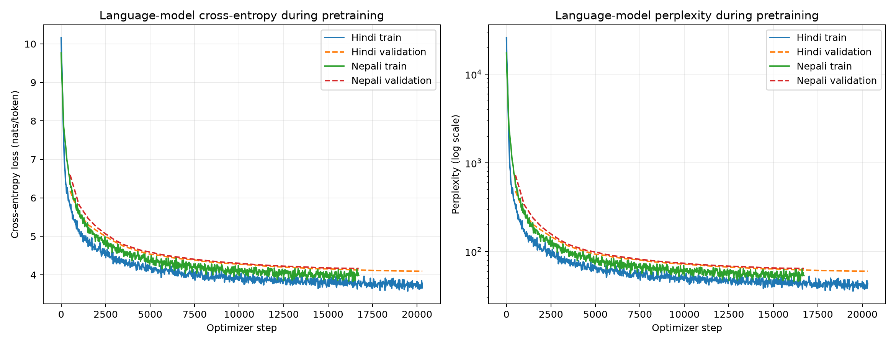
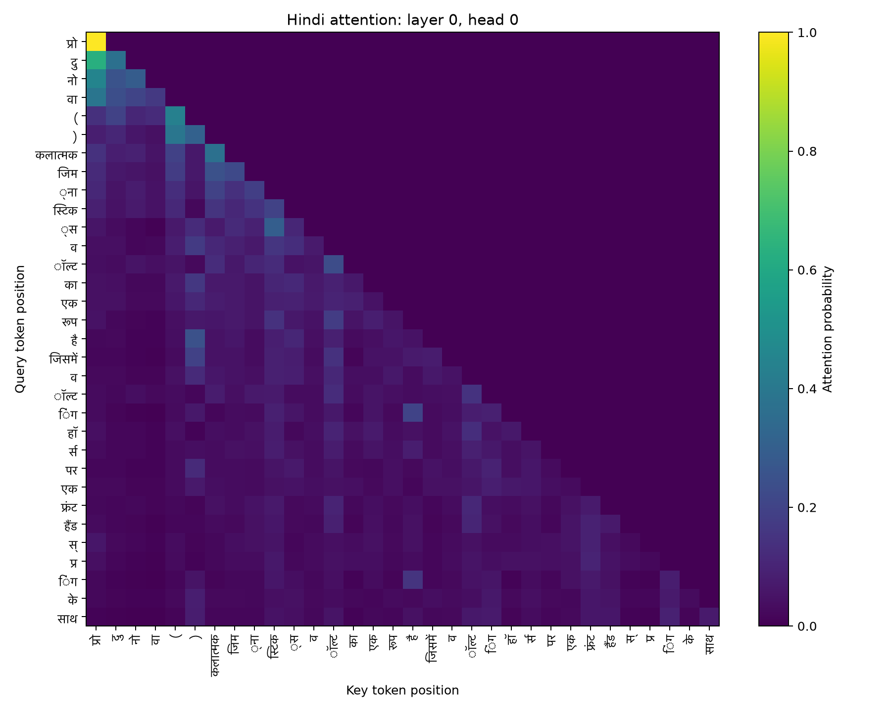
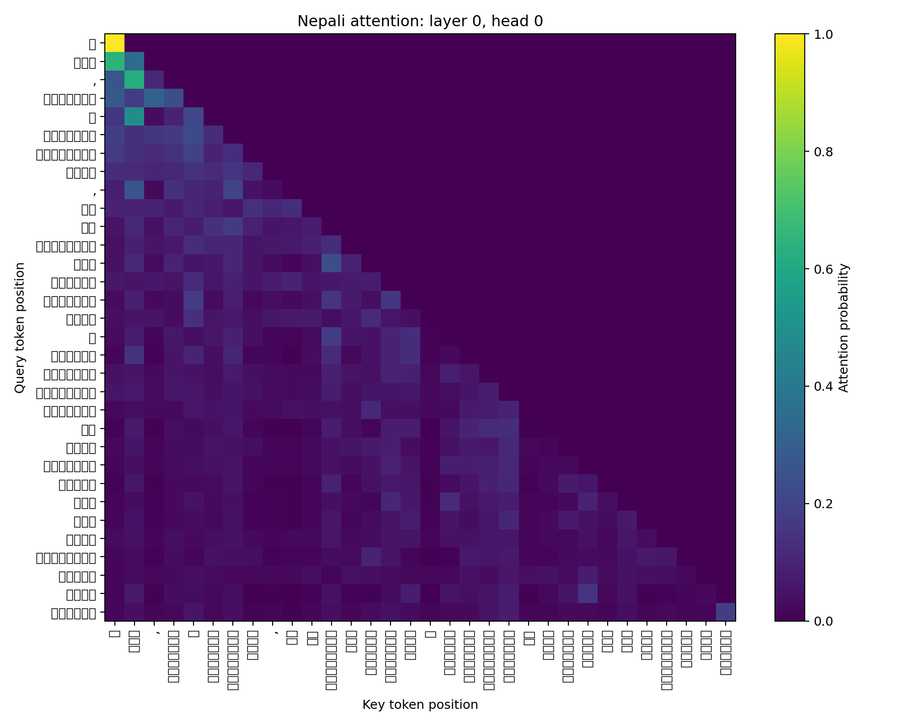
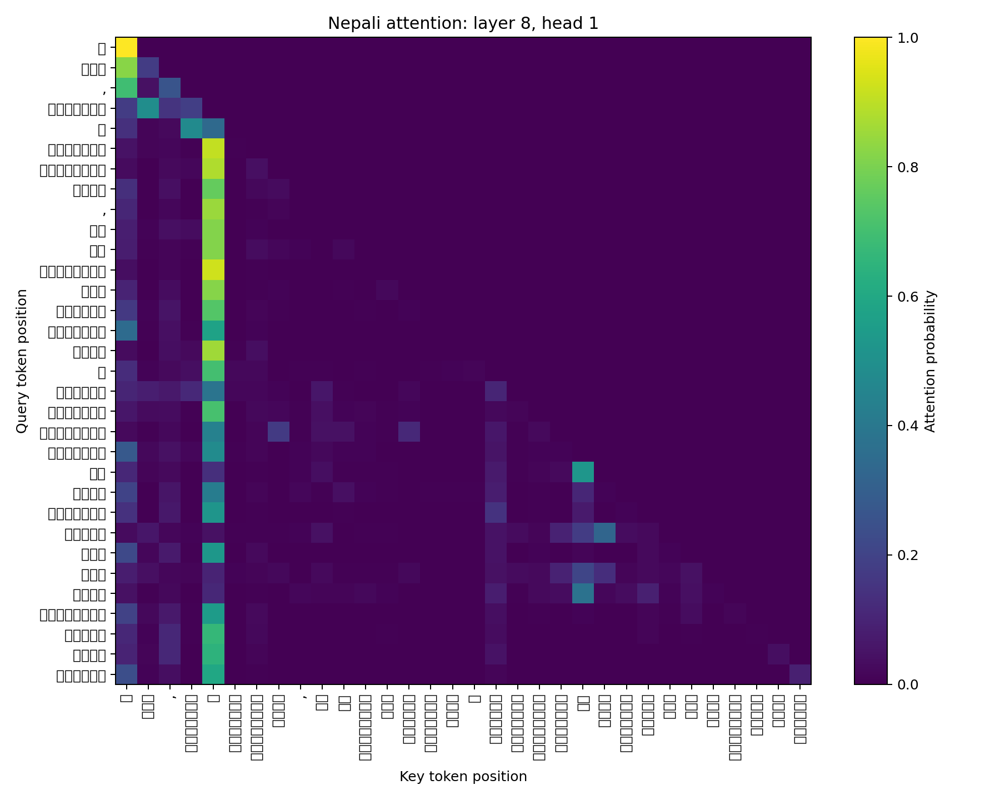

# Phase 2: Decoder-only Transformer Pretraining

## 1. Scope

Phase 2 trains two independent, approximately 25M-parameter causal language models from scratch:
Model H for Hindi and Model L for Nepali. Each model has its own corpus, SentencePiece tokenizer,
embedding table, Transformer weights, checkpoints, and evaluation outputs. No pretrained model or
Hugging Face model implementation is used.

The Hindi run was completed during the original Phase 2 work. The Nepali run was completed on
Kaggle on 14 September 2026 using the final Phase 1 Nepali corpus and selected 16,000-piece Unigram
tokenizer.

## 2. Data protection and packing

Both Phase 1 corpora were deduplicated before the deterministic 98/1/1 document split. Nepali used
corpus-wide exact-document and exact-paragraph deduplication, so a retained exact duplicate could
not be assigned to two splits. The separate cross-language audit found no exact Nepali document
matches against either the Hindi or Bhojpuri corpora. A post-split Nepali near-document audit was
not run; this is a limitation when interpreting the held-out scores.

The packing pass applies the same `normalize_tokenizer_input` function used by Phase 1 statistics,
encodes each document with its language tokenizer, appends EOS, and writes little-endian `uint16`
streams. The extra EOS token per document accounts for the difference between Phase 1 token totals
and packed stream totals.

| Language | Packed train tokens | Validation tokens | Test tokens |
|---|---:|---:|---:|
| Hindi | 336,995,217 | 3,479,648 | 3,521,023 |
| Nepali | 273,870,489 | 2,950,599 | 2,892,361 |

## 3. Transformer architecture

Both models use learned token and absolute-position embeddings, nine pre-normalized Transformer
blocks, six-head causal self-attention, GELU feed-forward layers, a final LayerNorm, and tied input
and output embeddings. Attention is implemented directly using scaled query-key products and an
explicit upper-triangular causal mask; the implementation does not call `nn.Transformer` or
`nn.MultiheadAttention`.

| Setting | Hindi | Nepali |
|---|---:|---:|
| Vocabulary size | 24,000 | 16,000 |
| Context length | 256 | 256 |
| Model dimension | 384 | 384 |
| Layers | 9 | 9 |
| Heads / head dimension | 6 / 64 | 6 / 64 |
| Feed-forward dimension | 1,536 | 1,920 |
| Dropout | 0.1 | 0.1 |
| Trainable parameters | **25,285,248** | **24,870,912** |

Nepali's smaller vocabulary saves embedding parameters. Its feed-forward width is therefore 1,920
rather than 1,536, keeping both models near the same total parameter budget while assigning more
of the Nepali model to Transformer computation.

## 4. Pretraining

Training uses AdamW with betas `(0.9, 0.95)`, weight decay 0.1, gradient clipping at 1.0, linear
warmup, and cosine decay from `3e-4` to `3e-5`. Runs use bfloat16 on CUDA, micro-batches of eight
256-token sequences, and eight-way gradient accumulation, giving 16,384 tokens per optimizer step.
Checkpoints contain model, optimizer, scheduler, scaler, random-number-generator, and sampling
generator state so interrupted Kaggle sessions can resume exactly.

| Result | Hindi | Nepali |
|---|---:|---:|
| Optimizer steps | 20,300 | 16,720 |
| Tokens processed | 332,595,200 | 273,940,480 |
| Approximate corpus passes | 0.99 | 1.00 |
| Warmup steps | 500 | 500 |
| Final train loss | 3.7794 | 3.9831 |
| Best/final validation loss | **4.0954** | **4.1663** |
| Final validation perplexity | **60.06** | **64.48** |

The Nepali log contains 871 finite observations and 34 validation points. Its final validation
point is also its best recorded validation loss. The checkpoint reloads strictly into the declared
architecture with all 113 state tensors matching and the expected 24,870,912 parameters.

Final checkpoints are kept outside Git because each is roughly 300 MB. The Nepali checkpoint is
`checkpoint_step_0016720.pt` (285 MB), SHA-256
`bba29e31aeda8f7681fc6929f5bf0f613e2c089e0f6eddcede2e0cc8b2ed6712`.

## 5. Held-out evaluation

The evaluator scores every next-token target in the packed test stream. Perplexity is dependent on
the tokenizer vocabulary; bits per UTF-8 byte (BPB) offers a more comparable intrinsic measure.

| Test metric | Hindi | Nepali |
|---|---:|---:|
| Tokens scored | 3,521,022 | 2,892,360 |
| UTF-8 bytes | 35,374,088 | 37,071,530 |
| Cross-entropy (nats/token) | **3.6782** | **3.8888** |
| Perplexity | **39.57** | **48.85** |
| Bits per UTF-8 byte | **0.5282** | **0.4377** |

Hindi has lower token-level cross-entropy and perplexity, while Nepali has lower BPB. This reversal
is possible because the tokenizers segment text differently: Hindi uses a 24k vocabulary and Nepali
uses 16k. The full-test scores are lower than periodic validation estimates because evaluation uses
the complete test stream whereas training uses a fixed sample of validation windows.

## 6. Generation evaluation

Fifty test documents are selected deterministically by hashing their document IDs. Each supplies a
32-token prefix and 64-token reference continuation. The model generates one greedy continuation
and samples at temperatures 0.5, 1.0, and 1.5. BLEU-4, chrF++, and ROUGE-L measure overlap with the
single reference; Distinct-1/2 and repeated four-grams measure diversity and repetition.

| Language / decoding | BLEU-4 | chrF++ | ROUGE-L | Distinct-1 | Distinct-2 | Repeated 4-gram |
|---|---:|---:|---:|---:|---:|---:|
| Hindi greedy | 1.02 | 9.34 | 0.102 | 0.153 | 0.283 | 0.636 |
| Hindi temperature 0.5 | 1.42 | 12.44 | 0.115 | 0.235 | 0.536 | 0.215 |
| Hindi temperature 1.0 | 0.42 | 13.35 | 0.092 | 0.493 | 0.897 | 0.002 |
| Hindi temperature 1.5 | 0.11 | 14.15 | 0.042 | 0.767 | 0.998 | 0.000 |
| Nepali greedy | 1.80 | 15.67 | 0.102 | 0.166 | 0.277 | 0.642 |
| Nepali temperature 0.5 | **2.22** | 18.55 | **0.117** | 0.327 | 0.627 | 0.169 |
| Nepali temperature 1.0 | 1.21 | **19.99** | 0.095 | 0.546 | 0.934 | 0.002 |
| Nepali temperature 1.5 | 0.23 | 16.18 | 0.029 | **0.747** | **0.994** | **0.000** |

For Nepali, temperature 0.5 gives the best observed overlap/repetition compromise. Greedy decoding
has substantial phrase repetition. Temperature 1.0 nearly eliminates repeated four-grams and
increases diversity, while 1.5 often drifts into weakly connected fragments. These overlap metrics
have limited semantic meaning because open-ended prompts admit many valid continuations.

## 7. Attention analysis

Attention was extracted from all nine layers and six heads for the first deterministic evaluation
prefix. All 54 rows are retained for each model. The empty upper-right triangle in the heatmaps
confirms causal masking.

| Summary | Hindi | Nepali |
|---|---:|---:|
| Layer 0 mean entropy | 2.360 | 2.329 |
| Layer 8 mean entropy | 1.821 | 1.626 |
| Layer 0 mean attention distance | 6.839 | 6.930 |
| Layer 8 mean attention distance | 6.914 | 8.752 |
| Most local head | L4H1, 1.202 | L4H3, 0.983 |
| Most long-range head | L6H4, 14.105 | L6H2, 13.730 |

Later layers have lower mean entropy for both models, indicating sharper attention distributions on
this example. Nepali's final layer also has a larger mean backward distance than its first layer.
These are descriptive results from one fixed prefix and do not establish a general linguistic role
for any head.

| Hindi early/late heads | Nepali early/late heads |
|---|---|
|  |  |
|  |  |

## 8. Reproducibility artifacts

The repository includes the model implementation, experiment configurations, Kaggle notebook and
runner, compact training logs, resolved configurations, environment captures, complete evaluation
JSON files, 200 generated continuations per language, attention tables, heatmaps, and training
curves. Large corpora, packed streams, upload bundles, and checkpoints remain outside Git.

- Hindi configuration: `hindi/configs/phase2.toml`
- Nepali configuration: `nepali/configs/phase2.toml`
- Kaggle workflow: `kaggle/phase2_kaggle.ipynb`
- Results: `report/results/generated/phase2/`
- Samples: `report/samples/generated/phase2/`
- Logs and run metadata: `report/logs/generated/phase2/` and `report/runs/generated/phase2/`
- Attention outputs: `report/tables/generated/phase2/` and
  `report/figures/generated/phase2/attention/`
