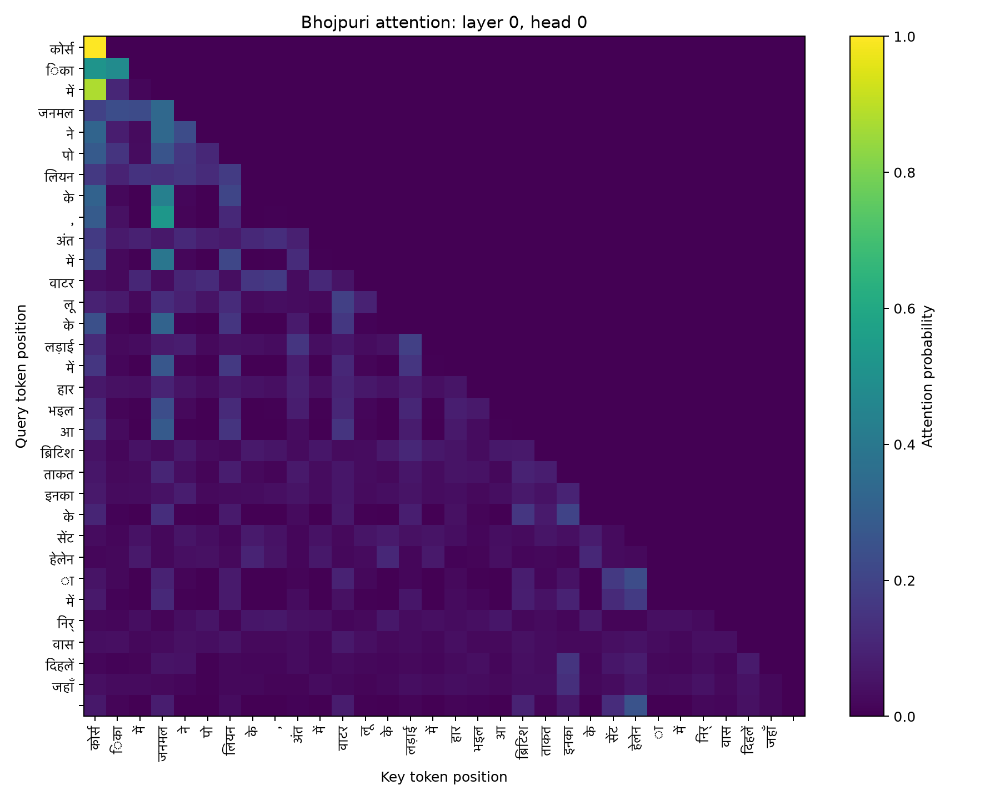
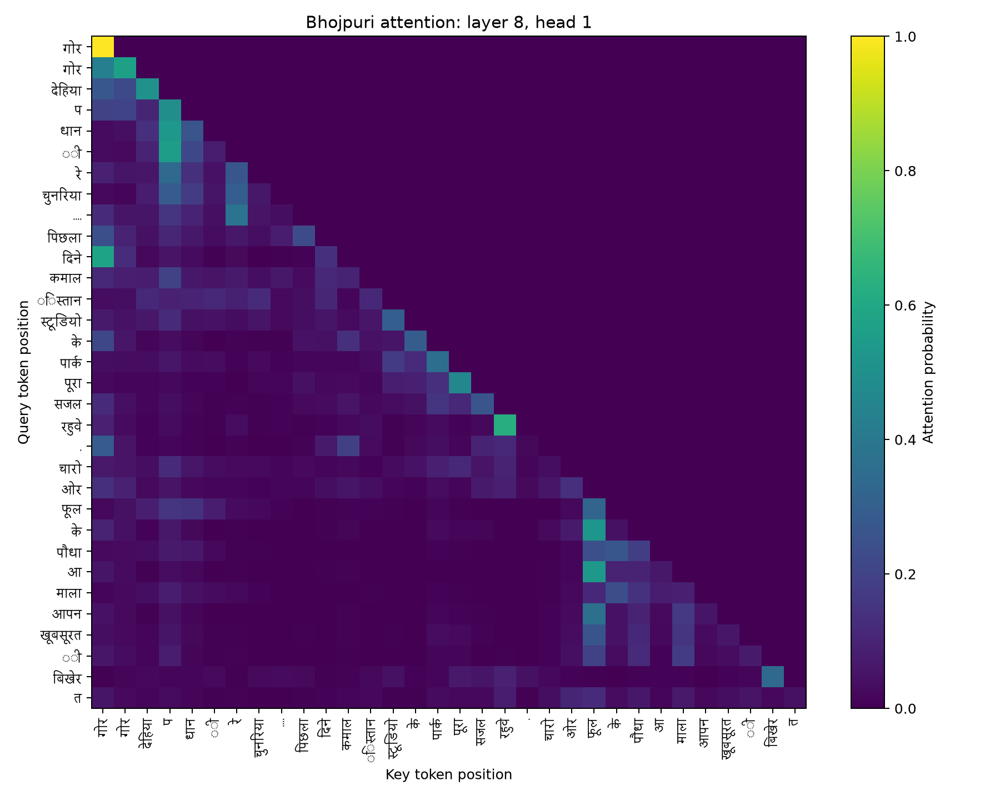

# Phase 2: Decoder-only Transformer Implementation and Training

## 1. Pre-training split decontamination

Validation and test documents are protected before any model sees the training split. The audit
is asymmetric: it searches training against held-out data, records candidates, and never modifies
validation or test. This prevents evaluation leakage while preserving the original held-out sets.

### 1.1 Detection methods

The implementation in `src/lma_phase2/decontaminate.py` performs three checks:

1. **Exact document:** SHA-256 of NFC-normalized, case-folded, whitespace-collapsed text.
2. **Exact paragraph:** the same hash over line-preserving paragraphs with at least 100 characters
   and 15 words.
3. **Near document:** Bottom-k MinHash over word 5-grams, with sketch size 64, index prefix size 16,
   at least two shared prefix hashes, and estimated Jaccard similarity at least 0.95.

Match precedence is exact document, near document, then exact paragraph, so one training document
appears at most once in the review set. SQLite holds protected signatures, completed training IDs,
and candidate pairs, making a stopped audit safe to resume. Parallel workers compute immutable
text features, while matching and database writes remain ordered and single-writer.

### 1.2 Full-corpus audit results

| Language | Protected validation + test documents | Training documents checked | Exact documents | Exact paragraphs | Near documents | Flagged training documents |
|---|---:|---:|---:|---:|---:|---:|
| Hindi | 45,806 | 2,237,951 | 0 | 0 | 75 | 75 |
| Bhojpuri | 4,695 | 225,992 | 0 | 253 | 107 | 360 |

The absence of exact-document matches in both languages is consistent with the corpus-wide exact
deduplication completed before splitting. Hindi also has no exact-paragraph leakage. Its 75 near
candidates are all IndicCorp-to-IndicCorp pairs. Reviewed examples include genuine republications
with punctuation or dateline differences, but also distinct calendar-year pages sharing a fixed
template. Therefore, near candidates require pair-level review before removal.

Bhojpuri's candidates include clear copies across Bhojpuri Wikipedia and the downloaded
BhojpuriCorpus, as well as exact news paragraphs reused across Anjoria, `fish_food`, Wikipedia,
JNU-BHLTR, and blog sources. The exact-paragraph matches are strong evidence of held-out content
inside a larger training document. Near-document candidates still require review because the
MinHash score is an estimate.

### 1.3 Artifacts and decision boundary

- `report/audits/generated/hindi_decontamination_report.json`
- `report/audits/generated/hindi_train_heldout_matches.csv`
- `report/audits/generated/bhojpuri_decontamination_report.json`
- `report/audits/generated/bhojpuri_train_heldout_matches.csv`

The CSV files retain both sources, document IDs, URLs, text samples, protected split, similarity,
review decision, reviewer policy, and rationale. Review was completed on 25 August 2026 using a
user-directed threshold policy. For Hindi, the 9 near-document matches with estimated similarity
at least 0.97 were marked `remove`, while the remaining 66 were marked `keep`. For Bhojpuri, all
253 exact-paragraph matches and the 50 near-document matches with similarity at least 0.98 were
marked `remove`; the remaining 57 near-document matches were marked `keep`. Thus 312 training
documents are approved for removal across both languages. The official Google Drive splits remain
unchanged. Versioned replacements were generated after review, removing only the 312 approved
training documents. Their packed-data counts and checksums are recorded below; validation and test
remain byte-for-byte unchanged.

## 2. Transformer architecture

Both models use the same student-implemented decoder-only Transformer backbone: learned token and
absolute position embeddings, embedding dropout, nine pre-normalized blocks, a final LayerNorm,
and a tied token/output matrix. Each block contains six-head causal self-attention and a GELU
feed-forward network. No `nn.Transformer*`, `nn.MultiheadAttention`, Hugging Face model class, or
pretrained model component is used.

| Setting | Model H: Hindi | Model L: Bhojpuri |
|---|---:|---:|
| Vocabulary | 24,000 | 16,000 |
| Context length | 256 | 256 |
| Model dimension | 384 | 384 |
| Layers | 9 | 9 |
| Heads | 6 | 6 |
| Head dimension | 64 | 64 |
| Feed-forward dimension | 1,536 | 1,920 |
| Dropout | 0.1 | 0.1 |
| Exact trainable parameters | **25,285,248** | **24,870,912** |

The attention depth, model width, head count, and head dimension are held fixed to make the
resource-level comparison interpretable. Bhojpuri's smaller vocabulary saves 3.07M embedding
parameters, so some of that budget is reassigned to its feed-forward width while keeping both
models near 25M parameters. Weight tying avoids a second vocabulary-sized output matrix. Learned
absolute positions are simple and fully inspectable, but constrain inference to at most 256 tokens
without resizing and retraining the position table.

For an input `(B, T, 384)`, one linear layer produces Q/K/V and each is reshaped to
`(B, T, 6, 64)` and transposed to `(B, 6, T, 64)`. Attention scores have shape
`(B, 6, T, T)` and are divided by `sqrt(64)` before an explicit upper-triangular future mask and
softmax. Heads are transposed and concatenated back to `(B, T, 384)` before the output projection.
The scaling is needed because the variance of an unscaled query-key dot product grows with the
head dimension. Without it, large logits push softmax toward saturation, producing very small
gradients and unstable, overly sharp attention. Pre-norm keeps the residual path direct and is more
stable than post-norm for optimization.

Each component has a distinct role. Without token embeddings, discrete IDs have no learned vector
representation; without positional embeddings, attention cannot distinguish token order; without
the causal mask, training leaks future targets. Removing multiple heads eliminates parallel
attention subspaces, while removing the output projection prevents the concatenated heads from
being remixed. Residual paths and pre-normalization preserve gradient flow and control activation
scale; the feed-forward network supplies per-position nonlinear feature transformation. Dropout is
the principal regularizer. The final normalization stabilizes the scale presented to the language
model head, and without that head the model cannot produce vocabulary logits. Weight tying is not
mathematically required, but untying it would add 9,216,000 Hindi or 6,144,000 Bhojpuri parameters
and move both models far beyond the intended budget.

## 3. Packed data and pretraining protocol

The Phase 2 packing pass streams canonical JSONL, appends the language tokenizer's EOS ID after
every document, and writes little-endian `uint16` token streams. This avoids repeatedly tokenizing
hundreds of millions of tokens during training. It checkpoints at document boundaries and records
input, tokenizer, and binary SHA-256 checksums. Random training windows use a dedicated PyTorch
generator whose state is checkpointed; validation windows are sequential and deterministic.

The completed artifacts are recorded in
[`phase2_data_manifest.json`](audits/generated/phase2_data_manifest.json):

| Language | Train documents | Train tokens | Validation tokens | Test tokens | Removed train documents |
|---|---:|---:|---:|---:|---:|
| Hindi | 2,237,942 | 336,995,217 | 3,479,648 | 3,521,023 | 9 |
| Bhojpuri | 225,689 | 23,142,975 | 234,882 | 222,585 | 303 |

Both independent models completed their scheduled Kaggle GPU runs in bfloat16 with PyTorch
2.10.0 and CUDA 12.8. Before those runs, each full-size model also passed a one-step CPU train,
validation, checkpoint, and `--resume latest` smoke test.

| Setting/result | Hindi | Bhojpuri |
|---|---:|---:|
| Micro-batch sequences | 8 | 8 |
| Gradient accumulation | 8 | 8 |
| Effective tokens/step | 16,384 | 16,384 |
| Completed optimizer steps | 20,300 | 4,150 |
| Tokens processed | 332,595,200 | 67,993,600 |
| Approximate corpus passes | 0.99 | 2.94 |
| Peak / final learning rate | 3e-4 / 3e-5 | 3e-4 / 3e-5 |
| Warmup steps | 500 | 200 |
| Final logged train loss | 3.7794 | 4.0329 |
| Final validation loss | **4.0954** | **4.0676** |
| Final validation perplexity | **60.06** | **58.41** |

The requested approximately 500M-token scale is a target rather than a claim made by these runs.
After quality filtering, manual-source balancing, deduplication, and held-out decontamination, the
available unique streams contain about 337M Hindi and 23M Bhojpuri tokens. Hindi was trained for
one nearly complete corpus pass (332.6M processed tokens) to fit the student Kaggle compute budget.
Bhojpuri was trained for 2.94 passes (68.0M processed tokens) so that optimization was not cut off
after only a very short run; repeated passes do not turn its 23M-token corpus into 68M unique data.
The Bhojpuri collection shortfall and the deliberate exclusion of mistranslated, Hindi-dominant,
and damaged OCR sources are documented in the Phase 1 report. Thus neither run reaches 500M
processed tokens, and the comparison reports the actual counts rather than presenting repetition as
new data.

Training uses AdamW (`betas=(0.9, 0.95)`, weight decay 0.1), linear warmup, cosine decay,
gradient clipping at 1.0, and periodic validation. The final validation point is the best logged
validation loss for both runs. The noisier train lines are individual mini-evaluations, while the
dashed validation lines are deterministic multi-batch estimates.

Each atomic checkpoint contains model weights, optimizer and scheduler state, mixed-precision
scaler state, completed step, tokens seen, best validation loss, resolved configuration, all RNG
states, and the packed-data sampling-generator state. Final checkpoints are stored outside Git:

| Model | Checkpoint folder | SHA-256 | Size |
|---|---|---|---:|
| Hindi | [Google Drive](https://drive.google.com/drive/folders/1QS_l1VYF2A_ifCxQuEThoYDgqInpS7BF) | `575458df89393ca2b5998024f93d04e9a08a1a5228f420da389108cfed870d42` | 303,590,517 bytes |
| Bhojpuri | [Google Drive](https://drive.google.com/drive/folders/1HQMO4a_Ud18URPi_X4nBNCIPZPcHeyCN) | `69580b164964ddb88477fd39181f5d1a57ef52cfcaa32dbe1fc68e19b805c133` | 298,618,485 bytes |

The repository retains the compact training logs, resolved configurations, environments, and
latest-checkpoint metadata under [`report/`](.).

## 4. Held-out evaluation

The evaluator scores the complete decontaminated test streams. Bits per UTF-8 byte (BPB) is the
fairest direct comparison because the tokenizers have different vocabulary sizes; perplexity is
still reported, but is tokenizer-dependent.

| Test metric | Hindi | Bhojpuri |
|---|---:|---:|
| Tokens scored | 3,521,022 | 222,584 |
| UTF-8 bytes | 35,374,088 | 2,045,282 |
| Cross-entropy (nats/token) | **3.6782** | **4.1420** |
| Perplexity | **39.57** | **62.93** |
| Bits per UTF-8 byte | **0.5282** | **0.6503** |

Hindi performs better on the tokenizer-neutral BPB measure. The likely explanation is its much
larger unique training corpus: about 337M tokens versus 23M. Bhojpuri receives nearly three passes
through its smaller corpus, but repeated exposure cannot replace breadth. Test perplexity is lower
than the periodic validation perplexity because the former is an exact full-test calculation and
the latter is the training loop's fixed validation-window estimate.

Script is not a confound here because both corpora primarily use Devanagari. Tokenization differs
only modestly on held-out text: Hindi's selected 24k tokenizer has 1.2928 tokens/word and 3.986
characters/token, while Bhojpuri's selected 16k tokenizer has 1.3341 tokens/word and 3.764
characters/token. Bhojpuri is therefore slightly more fragmented, but the gap is small relative to
the roughly 14.6-fold difference in unique training tokens. Corpus scale, source diversity, and
formulaic repetition are the more plausible drivers of the BPB gap.

Generation uses 50 deterministic corpus-wide examples selected by SHA-256 of document ID, a
32-token prefix, a 64-token continuation, and seed 20260823. BLEU is corpus BLEU-4; chrF is chrF++;
ROUGE is mean token-level ROUGE-L F1. Distinct-1/2 are corpus unigram/bigram diversity, and lower
repeated 4-gram rate is better.

BLEU-4 measures exact word n-gram precision and rewards locally reference-like phrasing, but is
especially harsh when an open-ended prompt has many valid continuations. chrF++ compares character
n-grams plus word bigrams, making it more tolerant of inflection and spelling variation in Hindi
and Bhojpuri, although it still cannot judge truth or discourse coherence. ROUGE-L measures the
longest in-order token overlap, so it can recognize a reference-like phrase sequence even when all
4-grams do not match; it likewise misses factuality and penalizes valid alternative continuations.
For that reason, the three overlap scores are interpreted together with repetition, diversity, and
manual sample inspection rather than as standalone fluency scores.

| Language / decoding | BLEU-4 | chrF++ | ROUGE-L | Distinct-1 | Distinct-2 | Repeated 4-gram |
|---|---:|---:|---:|---:|---:|---:|
| Hindi greedy | 1.02 | 9.34 | 0.102 | 0.153 | 0.283 | 0.636 |
| Hindi temperature 0.5 | **1.42** | 12.44 | **0.115** | 0.235 | 0.536 | 0.215 |
| Hindi temperature 1.0 | 0.42 | 13.35 | 0.092 | 0.493 | 0.897 | 0.002 |
| Hindi temperature 1.5 | 0.11 | **14.15** | 0.042 | **0.767** | **0.998** | **0.000** |
| Bhojpuri greedy | **4.56** | 13.85 | 0.150 | 0.116 | 0.236 | 0.650 |
| Bhojpuri temperature 0.5 | 4.55 | 17.14 | **0.166** | 0.215 | 0.518 | 0.214 |
| Bhojpuri temperature 1.0 | 4.24 | **18.36** | 0.153 | 0.486 | 0.916 | 0.011 |
| Bhojpuri temperature 1.5 | 0.11 | 13.61 | 0.046 | **0.730** | **0.996** | **0.000** |

These overlap metrics should not be interpreted as general text quality scores: there is only one
valid held-out continuation for each open-ended prompt. Bhojpuri's higher overlap can coexist with
its worse intrinsic score because its smaller corpus contains more formulaic news and blog phrasing.

## 5. Qualitative generation analysis

Greedy decoding is visibly degenerate for both models. In one Hindi example it repeats “एक साथ”
through almost the entire continuation; a Bhojpuri example repeatedly emits “फिल्म के निर्देशक
हउवें अशोक कुमार”. This matches repeated 4-gram rates near 0.64–0.65. Temperature 0.5 is the best
observed coherence/diversity compromise: repetition falls to about 0.21 while ROUGE-L is highest
for both languages. It can still hallucinate facts and preserve corpus artefacts—for example, one
Bhojpuri continuation emits a page-view counter.

Temperature 1.0 almost eliminates repeated 4-grams and substantially increases diversity, but
names and topics drift away from the prefix. At 1.5, Distinct scores approach 1.0 because output is
largely disconnected fragments, sometimes mixing scripts or English tokens; its low repetition is
therefore not evidence of quality. The model is useful as a small from-scratch experimental LM,
not as a factual or production text generator. All 200 continuations per language are preserved in
[`hindi_samples.jsonl`](samples/generated/phase2/hindi_samples.jsonl) and
[`bhojpuri_samples.jsonl`](samples/generated/phase2/bhojpuri_samples.jsonl).

## 6. Attention analysis

Attention was extracted from the first deterministic evaluation prefix for all 9 layers and 6
heads. The CSV summaries contain mean attention entropy and mean backward attention distance for
all 54 heads per model. The blank upper-right triangle in every heatmap verifies causal masking.
Early layers distribute mass broadly; later heads are generally sharper and specialize into local
or long-range patterns.

The exact prefixes plotted in the heatmaps are:

- **Hindi:** “प्रोदुनोवा () कलात्मक जिम्नास्टिक्स वॉल्ट का एक रूप है जिसमें वॉल्टिंग हॉर्स पर एक फ्रंट हैंडस्प्रिंग के साथ”
- **Bhojpuri:** “गोर गोर देहिया प धानी रे चुनरिया.... पिछला दिने कमालिस्तान स्टूडियो के पार्क पूरा सजल रहुवे. चारो ओर फूल के पौधा आ माला आपन खूबसूरती बिखेरत”

| Summary | Hindi | Bhojpuri |
|---|---:|---:|
| Layer 0 mean entropy | 2.360 | 2.367 |
| Layer 8 mean entropy | 1.821 | 1.819 |
| Layer 0 mean attention distance | 6.839 | 7.183 |
| Layer 8 mean attention distance | 6.914 | 5.828 |
| Most local head | L4H1, distance 1.202 | L3H3, distance 2.197 |
| Most long-range head | L6H4, distance 14.105 | L7H2, distance 7.548 |

Hindi develops a particularly sharp local head at L4H1 (entropy 0.164) and a distinct long-range
head at L6H4. Bhojpuri's heads occupy a narrower distance range, and its final layer shifts toward
more local attention on this prefix. Diagonal and near-diagonal bands are positional/local patterns
because their selected key moves with the query position. In contrast, late-layer examples such as
Hindi L8H0 and Bhojpuri L8H0 show sparse off-diagonal peaks and repeated attention to selected
earlier token columns rather than one fixed offset; this is consistent with content-sensitive
retrieval. It is not proof of a linguistic function, because these are descriptive observations
from one fixed 32-token example. Establishing content-based specialization would require controlled
token substitutions across many examples.

| Hindi early head | Hindi late head |
|---|---|
|  |  |

| Bhojpuri early head | Bhojpuri late head |
|---|---|
|  |  |

All 12 heatmaps have explicit layer/head labels and a shared 0–1 probability scale. Devanagari
token labels were regenerated with an explicit compatible font after Kaggle's default font rendered
them as boxes. Complete head summaries are in
[`report/tables/generated/phase2`](tables/generated/phase2).

## 7. Reproducibility and conclusions

The two models use the same depth, width, heads, context, optimizer family, effective batch, and
decoding protocol. They differ only where the independent corpora and tokenizers require it:
vocabulary size, feed-forward width (to keep parameter counts comparable), schedule length, and
data volume. The higher-resource Hindi model wins on full-test BPB by 0.1221 bits/byte, supporting
the central resource-level hypothesis. Extra epochs over Bhojpuri improve exposure to its limited
data but also strengthen formulaic repetition, which appears in both greedy samples and overlap
metrics.

Small artifacts needed to audit the result are versioned in Git:

- evaluation JSON: [`report/results/generated/phase2`](results/generated/phase2)
- raw generation samples: [`report/samples/generated/phase2`](samples/generated/phase2)
- training logs: [`report/logs/generated/phase2`](logs/generated/phase2)
- configurations and run environments: [`report/runs/generated/phase2`](runs/generated/phase2)
- attention tables and figures: [`report/tables/generated/phase2`](tables/generated/phase2) and
  [`report/figures/generated/phase2`](figures/generated/phase2)

The final checkpoint locations, sizes, hashes, and terminal states are duplicated in
[`checkpoint_manifest.json`](results/generated/phase2/checkpoint_manifest.json). Large packed
streams and checkpoints remain in Google Drive and are deliberately excluded from Git.
